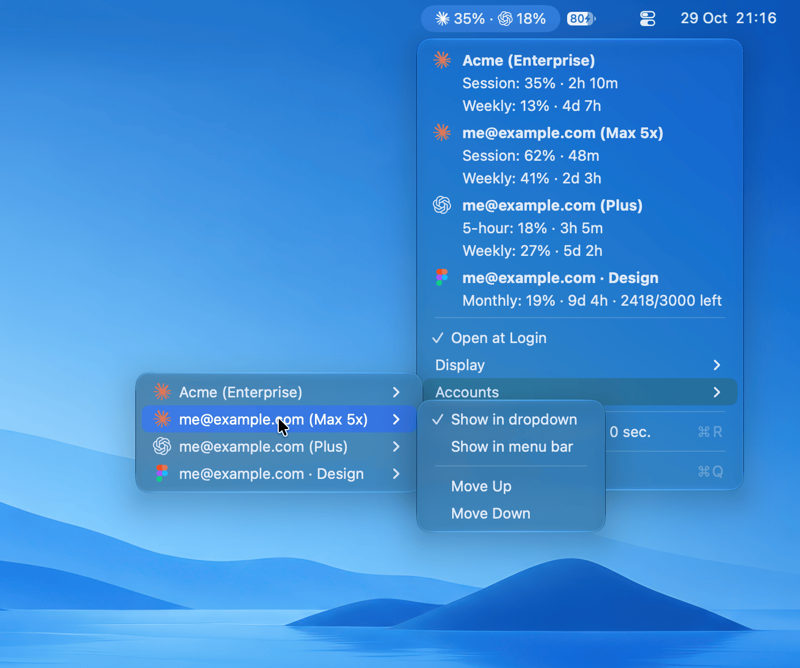
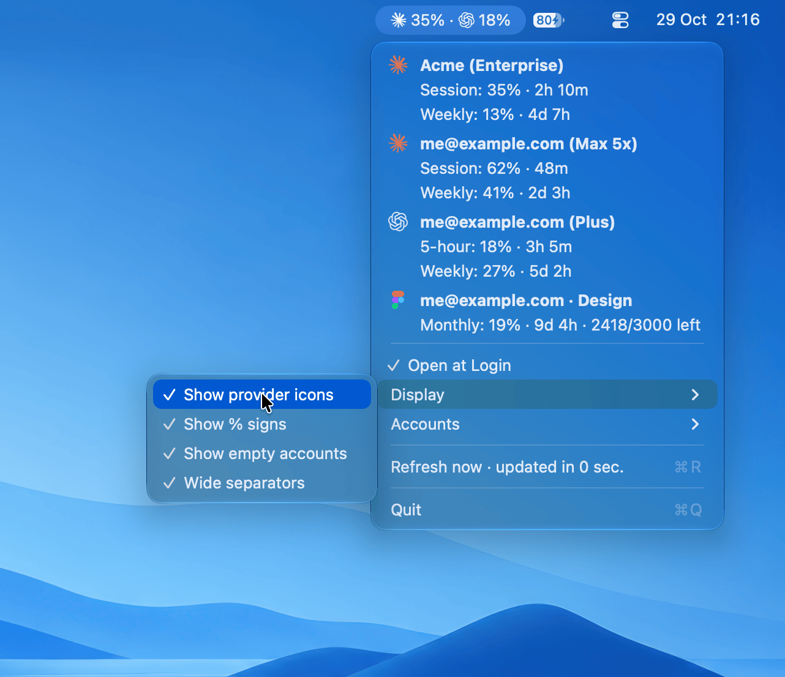

# AISubsUsage-MenuBar

macOS menubar app (AppKit `NSStatusItem`, no SwiftUI — builds with Command Line Tools alone) showing OpenAI (ChatGPT/Codex) + Claude + Figma subscription usage at a glance.


https://github.com/user-attachments/assets/8f3cadcb-bcd5-4ca4-8ca3-227fdfdfaf8a

Unlike scrapers, it calls the same OAuth-protected endpoints the CLIs use — no separate login, no API keys:

- OpenAI: `GET https://chatgpt.com/backend-api/wham/usage` with `~/.codex/auth.json` (`codex login`)
- Claude, one section per Desktop session (`~/Library/Application Support/Claude*/Cookies`, org name as header, cached):
  1. `GET https://claude.ai/api/organizations/{org}/usage` with the Claude Desktop app's `sessionKey` cookie (decrypted from the Cookies DB via Keychain `Claude Safe Storage` — **no CLI install needed**, just be logged into Claude Desktop; one retry on Cloudflare challenges). Org name and plan (Free, Pro, Max, Team…) come from `GET /api/organizations`, re-read at startup and on manual Refresh
  2. Fallback when no Desktop session exists: `GET https://api.anthropic.com/api/oauth/usage` with the Claude Code CLI login (Keychain `Claude Code-credentials`, else `~/.claude/.credentials.json`). Read-only — the token is never refreshed, so run `claude` to renew an expired login. Default config dir only (`CLAUDE_CONFIG_DIR` logins are not read).
- Figma, one section per owned plan, `account email · team` as header (`~/Library/Application Support/Figma/DesktopProfile/*/Cookies`, decrypted via Keychain `Figma Safe Storage` — just be logged into Figma Desktop):
  1. `GET https://www.figma.com/api/shared_with_you/plan_filter_options` for plan list
  2. `GET https://www.figma.com/api/plans/{plan}/ai_credits/plan_user_balance_summary` for seat monthly/daily AI credits
  - One Desktop cookie jar can hold several Figma logins: the session is scoped per account (single-entry `authn`), and plans are filtered to the account's own teams (`/api/user/state`) — shared-file teams are skipped.

## Requirements

- macOS 14+
- At least one of: Claude Desktop or Claude Code (`claude`) signed in, Codex app or CLI signed in (`codex login`), Figma Desktop signed in
- On first launch, macOS asks to let `security` read the matching Keychain item — click **Always Allow**

## Terms of use

All three providers' terms restrict programmatic access, and Anthropic's Claude Code terms forbid third-party tools from collecting Claude.ai credentials or session tokens. This app reads your own logins locally, read-only, and only sends them to the provider they belong to — but use it at your own risk.

## Privacy

- Logins are read locally, kept in memory only, and sent only to the provider they belong to (claude.ai / api.anthropic.com, chatgpt.com, figma.com).
- No analytics, no update checks, no server of its own. Read-only: it never changes or renews your logins.

## Install from source

Needs Xcode or the Command Line Tools (`xcode-select --install`).

```sh
git clone https://github.com/trgnn/AISubsUsage-MenuBar.git
cd AISubsUsage-MenuBar
make install     # release build -> /Applications/AISubsUsage-MenuBar.app
open /Applications/AISubsUsage-MenuBar.app
```

## Development

```sh
swift run        # dev (Dock icon flashes briefly)
make test        # unit tests (Swift Testing): parsing, plan names, ordering, cookie decryption
make check       # tests + release bundle + scan for secrets / personal data before pushing
AISUBS_FORCE_CLAUDE_CODE=1 swift run AISubsUsageMenuBar --test   # headless fetch, Claude Code path
open -a /Applications/AISubsUsage-MenuBar.app --args --demo   # demo mode: fake accounts, separate settings, no logins read
```

## What it shows

- Menubar: one value per visible account, in your order (default Claude sessions, then OpenAI, then Figma plans); consecutive same-provider values share one icon. Provider glyphs shown by default, toggleable.
- Options: Open at Login (via SMAppService), Display ▸ (Show provider icons, Show % signs, Show empty accounts, Wide separators — each individually toggleable), Accounts ▸ to show/hide each subscription and reorder it (Move Up / Move Down, one order shared by the menubar and the dropdown; default Claude, OpenAI, Figma, Figma plans biggest quota first)
- Dropdown: one section per account in the same order, headed by the provider's colour icon and the account name with its plan:
  - Claude: 5h session, weekly all-models, Sonnet/Opus and model-scoped weeklies, extra-usage (internal codename buckets are hidden)
  - OpenAI: 5-hour / weekly windows (detected via `limit_window_seconds`), per-model caps, banked resets
  - Figma: monthly + daily seat AI credits per plan, with remaining count
  - Time until each limit resets, auto-refresh every 60s, manual Refresh (⌘R)

<p>
  
  
</p>

## Notes

- All endpoints are **undocumented internals** — they can change without notice. Parsing is defensive (optional fields, codename fallback `seven_day_omelette` = Opus weekly).
- HTTP 429 on Claude's endpoint means back off (default retry 5 min); re-login on 401.
- API-key mode (`OPENAI_API_KEY` / `ANTHROPIC_API_KEY` without subscription OAuth) has no subscription usage — the app shows the sign-in hint instead.

## License

MIT No Attribution (MIT-0) — see [LICENSE](LICENSE): use it however you like, no credit needed. Not affiliated with Anthropic, OpenAI or Figma; product names and logos belong to their owners.

`Assets/openai.svg` comes from [LobeHub Icons](https://github.com/lobehub/lobe-icons) (`@lobehub/icons-static-svg` 1.95.0), MIT License, © LobeHub.
